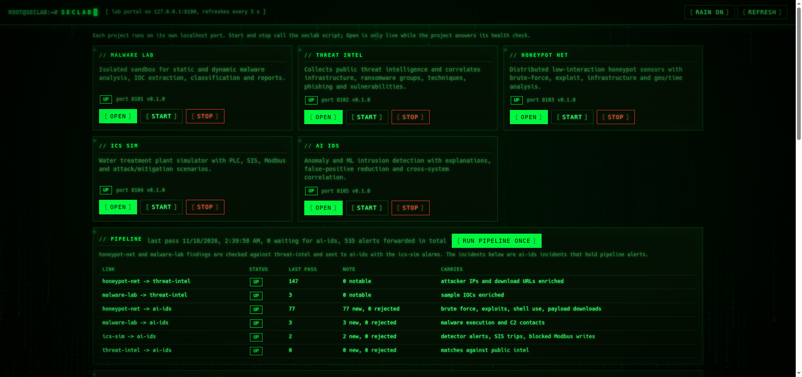

[](https://github.com/ikerscode/seclab/actions/workflows/tests.yml)

# seclab

A set of small, local security labs that I use to practise and demonstrate defensive
security work. Each lab is its own project with its own server and web dashboard. A
portal on port 8100 starts them, stops them and shows whether each one is up.

Everything listens on 127.0.0.1 only. Nothing here is meant to be exposed to a network.



## Quick start

```
git clone https://github.com/ikerscode/seclab.git portal      # plus the five lab repos next to it
./portal/seclab up        # pulls the latest code, then starts the portal and all five labs
# open http://127.0.0.1:8100
./portal/seclab demo      # optional: scripted run of the whole detection pipeline (about 30 s)
./portal/seclab down      # stop everything
```

Nothing starts by itself at login. `up` and `down` are the only things that start or stop
the stack. Layout and per-project setup are described below.

## Projects

| Project       | Port | What it is                                                                                  |
|---------------|------|---------------------------------------------------------------------------------------------|
| portal        | 8100 | Status page and launcher for the other projects                                             |
| malware-lab   | 8101 | Isolated sandbox for static and dynamic malware analysis, IOC extraction and reports         |
| threat-intel  | 8102 | Public threat intelligence, correlated by infrastructure, ransomware groups and techniques  |
| honeypot-net  | 8103 | Low-interaction honeypot sensors (SSH and Telnet on 2222 and 2323, HTTP on 8180) and analysis |
| ics-sim       | 8104 | Water treatment plant simulator with a PLC, a safety system, Modbus and attack scenarios    |
| ai-ids        | 8105 | Anomaly and ML intrusion detection with explanations and cross-system correlation           |

Each project has a `run.sh` that starts its server, a `GET /api/health` endpoint that the
portal polls, and a dashboard at its own port.

## Layout

```
seclab/
  portal/          launcher, status server and page (this project's code lives here)
    seclab         command line script for starting and stopping projects
    server.py      stdlib HTTP server on 127.0.0.1:8100
    pipeline/      cross-lab bridge (stdlib only) and the scripted demo
    tests/         pytest suite for the bridge, with fixtures copied from real lab answers
    static/        index.html plus the shared hud.css and hud.js
  _shared/         HUD files that are copied into each project's static/ folder
  malware-lab/     each sibling project is its own git repository
  threat-intel/
  honeypot-net/
  ics-sim/
  ai-ids/
  .run/            pid and log files written by seclab (not committed)
  seclab           symlink to portal/seclab
```

## Using the seclab script

Run it from the seclab folder, or through the symlink from anywhere.

```
./seclab up [--no-update]   pull the latest code, then start the portal and all five labs
./seclab down               stop all five labs and the portal
./seclab update             git pull --ff-only in every repo (never merges, skips repos with local changes)
./seclab start all          start every project in the background
./seclab start ics-sim      start one project
./seclab stop all           stop every project (TERM, then KILL after 5 seconds)
./seclab status             show port, pid, running state and health of each project
./seclab logs honeypot-net  follow one project's log
./seclab portal             run the portal in the foreground on 127.0.0.1:8100
./seclab tui [--once]       terminal view: projects, pipeline links and incidents (s start, x stop, p pipeline pass)
./seclab pipeline           one pass of the cross-lab pipeline (see below)
./seclab pipeline --watch   a pass every 30 seconds until Ctrl+C
./seclab demo               scripted end-to-end demo of the whole lab
```

`start` runs the project's `run.sh` in its own process group, so `stop` can end the whole
process tree. Logs go to `.run/<name>.log` and the pid goes to `.run/<name>.pid`. A
project that is already running is skipped rather than started twice.

## Using the portal

Start the portal with `./seclab portal` and open http://127.0.0.1:8100/ in a browser.
Each project has a card that shows whether it is up, its version and its port. The
Open button goes to the project's dashboard in a new tab, and it is only active while
the project answers its health check. Start and Stop call the same script as the
command line. The page refreshes every five seconds.

The portal only accepts requests addressed to 127.0.0.1 or localhost, and it only
starts or stops the five known project names.

## Notes

- The portal checks health on the server side, so the browser never talks to the
  project ports directly.
- Each sibling project is a separate git repository and is built and documented on its
  own. This folder only holds the launcher, the portal and the shared front-end files.
- Nothing is containerised by the portal itself. Any Docker use is inside the projects.

## Layout

The portal expects the projects as siblings in one folder:

```
seclab/
  portal/          this repo
  malware-lab/  threat-intel/  honeypot-net/  ics-sim/  ai-ids/
  seclab -> portal/seclab
```

Clone each repo into the same folder and run `ln -s portal/seclab seclab` once.

## Cross-lab pipeline

On their own the five labs are separate demos. The pipeline joins them into one small
SOC: the sensors (honeypot, sandbox, plant) report to the IDS, threat intelligence adds
context on the way, and the IDS incidents are where everything ends up.

```
  honeypot-net :8103                 malware-lab :8101               ics-sim :8104
  attacker IPs, payload URLs,        verdict, ATT&CK, C2 IPs,        detector alerts, SIS trips,
  credential campaigns               domains, URLs, sha256           blocked / rejected Modbus writes
        |                                  |                                |
        |  GET /api/infrastructure         |  GET /api/samples              |  GET /api/runs, /api/runs/{id}
        |      /api/campaigns              |      /api/samples/{sha}        |      /api/events, /api/modbus
        |      /api/events                 |                                |      /api/state, /api/meta
        v                                  v                                |
  +--------------------------------------------------+                     |
  | portal/pipeline (bridge.py, mapping.py)          |<--------------------+
  |  validate -> map -> dedup -> outbox -> batch     |
  +--------------------------------------------------+
        |   POST /api/enrich (IOCs)        ^
        v                                  |  verdict, tags (tor-exit, in-drop, botnet-c2),
  threat-intel :8102  ---------------------+  malware family, linked groups, DROP netblock
        |
        |   POST /api/ingest  {"alerts": [...]}     (honeypot-net, malware-lab, ics-sim,
        v                                            threat-intel as alert sources)
  ai-ids :8105  correlation -> incidents
        |
        |   GET /api/incidents, /api/incidents/{id}
        v
  portal: GET /api/pipeline, web panel, tui views "Pipeline" and "Incidents"
```

### Data flow

1. The bridge checks `/api/health` of every lab. A lab that is down only switches off
   the links that need it; the others still run.
2. It polls each source lab incrementally. Cursors live in `.run/pipeline-state.json`:
   per attacker IP the counters already reported, the newest honeypot download event id,
   a signature (verdict, category, score) per analysed sample, the ics-sim run ids already
   read and the newest live event and Modbus ids.
3. Every value from honeypot-net and malware-lab is treated as hostile (`pipeline/clean.py`):
   types are checked, text is cut and stripped of control characters and escape
   sequences, IPs, domains, hashes and technique ids must match strict patterns, and
   URLs are only split as text so their host can be checked. No URL is ever requested
   and nothing is executed. Records that fail are counted as rejected and dropped.
4. New indicators (attacker IPs, payload URLs and hosts, sample hashes, C2 IPs and
   domains) go to threat-intel in batches. Answers are cached for six hours. The intel
   context is added to the alert details, and a real match (or an address inside a
   Spamhaus DROP netblock) also becomes its own `threat-intel` alert with the same
   entities, so ai-ids lists threat-intel among the systems that saw the activity.
5. Alerts are checked locally against the ai-ids schema (`make_alert`), given a dedup
   key and queued in the outbox. The outbox is sent in batches of 200. If ai-ids refuses
   some alerts (HTTP 422) those are logged and dropped and the rest of the batch is sent
   again once. If ai-ids is down the outbox waits for the next pass.
6. The bridge reads the ai-ids incidents back and keeps the ones that contain at least
   one alert it sent, with the systems that contributed to each.

### What each link sends

| Link | ai-ids category | ATT&CK / stage | Entities |
|------|-----------------|----------------|----------|
| honeypot-net -> ai-ids | `bruteforce`, `web_exploit`, `honeypot_shell_exec`, `honeypot_scan` (one per behaviour whose counter went up) | T1110, T1190, T1059, T1595 | `src_ip` = attacker. The decoy is not sent as a target (see limitations) |
| honeypot-net -> ai-ids | `payload_download` (URL typed into the fake shell) | T1105, command_and_control | `src_ip` = attacker, `dst_ip`/`dst_host` = payload host |
| malware-lab -> ai-ids | `malware_exec` for malicious or suspicious samples | first Execution/Persistence technique of the analysis, else T1204 | `src_host` = host the sample was found on, else `sample-<sha12>` |
| malware-lab -> ai-ids | `c2_beacon` per external IP or domain in the IOCs | T1071.001, command_and_control | `src_host` as above, `dst_ip`/`dst_port` or `dst_host` = C2 |
| ics-sim -> ai-ids | `modbus_blocked`, `modbus_write_rejected`, `modbus_write_blocked`, `ics_anomaly`, `hmi_integrity`, `sis_trip`, `sis_bypass`, `process_hazard`, `plc_fault`, `plc_program_download`, `operator_report` | T0855, T0836, T0856, T0880, T0831, T0814, T0843 | `src_host` = attacking host (from the scenario or the blocked request), `dst_host` = PLC-01 or SIS-01 |
| threat-intel -> ai-ids | `intel_match` | copied from the alert it belongs to | copied from the alert it belongs to |
| honeypot-net / malware-lab -> threat-intel | `POST /api/enrich {"iocs": [...]}` with `record=false`, so the intel database is not changed | | |

Campaign membership from `/api/campaigns` (label, size) is added to the details of each
attacker IP's alerts. Every alert carries `details.via = "seclab-pipeline"`.

How the IT-to-OT chain becomes one incident: ai-ids joins alerts whose actor is the
same entity within two hours. When a sample is attributed to the workstation that the
ICS attack comes from (CORP-WS-37 in the `setpoint_change` scenario), the malware
execution, its C2 contacts and the blocked PLC writes all have `src_host` CORP-WS-37 and
land in one incident that walks from execution through C2 to impact, with malware-lab,
ics-sim (and threat-intel when an IOC matched) as systems.

The bridge also lists indicators that more than one lab reported, for example a host a
honeypot attacker downloaded from that is also a sample's C2 address.

### Running it

```
./seclab start all                       # or start the labs you want
./seclab pipeline                        # one pass, prints links, counts and incidents
./seclab pipeline --watch 60             # a pass every 60 s
./seclab pipeline --malware-host CORP-WS-37   # attribute not yet forwarded samples to a host
./seclab pipeline --status               # last report, contacts nothing
./seclab pipeline --json                 # report as JSON
```

The portal page has a Pipeline panel (link status, incidents with pipeline alerts,
indicators seen by more than one lab) and a "Run pipeline once" button. The terminal
view has two more views, Pipeline and Incidents, and `p` runs a pass. Only one pass runs
at a time (a lock file next to the state file).

Portal API: `GET /api/pipeline` returns the last report with each link re-checked
against live health, and `POST /api/pipeline/run` runs one pass.

### Scripted demo

`./seclab demo` waits for the shared CPU lock (`$XDG_RUNTIME_DIR/seclab-cpu.lock`), runs
at nice 19, and then:

1. starts threat-intel, waits for its health check, seeds the offline fixtures if its
   database is empty
2. starts honeypot-net, injects two days of simulated attacks at half scale
3. starts malware-lab and analyses the `c2_beacon` specimen: in the Docker sandbox when
   the sandbox image exists, otherwise a static-only analysis of the specimen file
4. starts ics-sim and runs `setpoint_change` once in fast mode (detector, firewall, SIS on)
5. starts ai-ids and trains on the simulated dataset only if no model exists
6. runs one pipeline pass, with the demo sample attributed to the scenario's attacking
   workstation, and prints the incidents and the indicators seen by several labs
7. stops every lab it started, also after an error or Ctrl+C (labs that were already
   running stay up)

The data the demo adds is all simulated and stays in each lab's own database.

### Tests

```
cd portal && python3 -m pytest -q
```

The fixtures in `tests/fixtures/` are trimmed copies of real answers from the five labs.
The tests cover the mapping functions (including hostile values: escape sequences, odd
URL schemes, overlong strings, wrong types, private and loopback addresses), dedup and
cursor advance, cursor reset after a lab database is purged, the ai-ids schema rules,
a full pass against fake lab HTTP servers, a refused alert inside a batch, fail-soft
behaviour with closed local ports, the outbox while ai-ids is down, redirect refusal and
the portal view.

### Safety notes

- Every call goes to 127.0.0.1 on the fixed lab ports, proxies from the environment are
  ignored, redirects are refused, every call has a timeout and answers over 8 MB are
  refused.
- URLs and domains from attackers and samples are defanged (`hxxp`, `[.]`) wherever
  they are shown, and are never fetched.
- The state file holds attacker IPs and sample hashes, so it is written with umask 077
  (mode 0600) and replaced atomically. Every collection in it is capped.

### Limitations

- honeypot-net's `/api/infrastructure` only returns the 50 most active IPs, and
  `/api/events` the newest 1000 events, so a very busy honeypot between two passes can
  be under-reported. Run `--watch` with a shorter interval in that case.
- Decoys are not sent as alert targets. ai-ids links alerts that share a victim within
  two minutes, and every attacker hits the same decoys, so sending them would merge
  unrelated attackers into one incident.
- ics-sim fast runs simulate hours in seconds. The bridge places the run's last event
  at the moment the run was saved and keeps the simulated spacing before it. Live events
  are placed using the current simulation speed, which is approximate if the speed was
  changed while the events happened. Real-time scenario runs are not read from
  `/api/runs`, because their events already arrived through the live feed.
- ics-sim and the ai-ids simulator use overlapping private addresses (10.10.2.10 is
  HMI-01 in one and web01 in the other), so OT alerts carry host names only, with the
  simulated IP in the details.
- Where a sample was found is not something malware-lab knows. Without
  `--malware-host` (or the demo's per-sample attribution) each sample is its own entity
  and only joins other alerts through a shared C2 target within two minutes.
- Alerts sent while threat-intel was down are not enriched later.
- Incident ids in ai-ids are recomputed as alerts arrive, so an id can change between
  passes. The pipeline view only lists the 40 strongest incidents that touch its sources.
